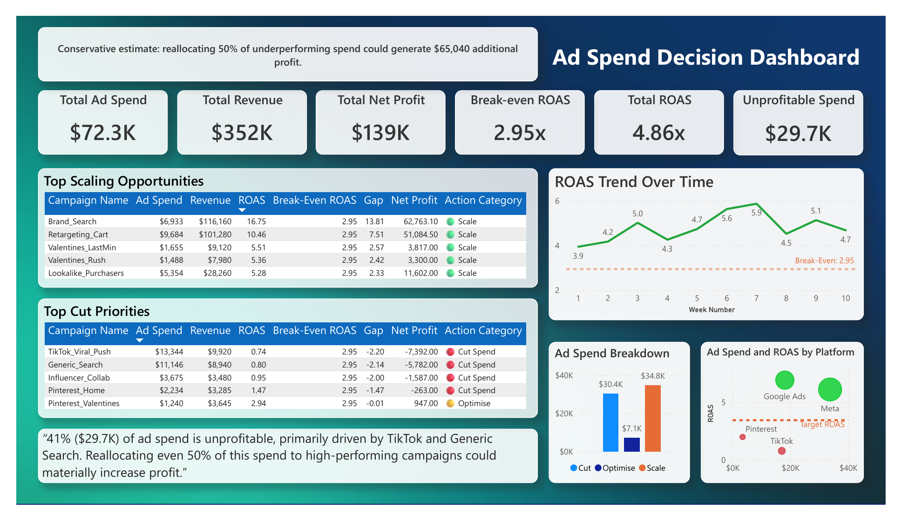
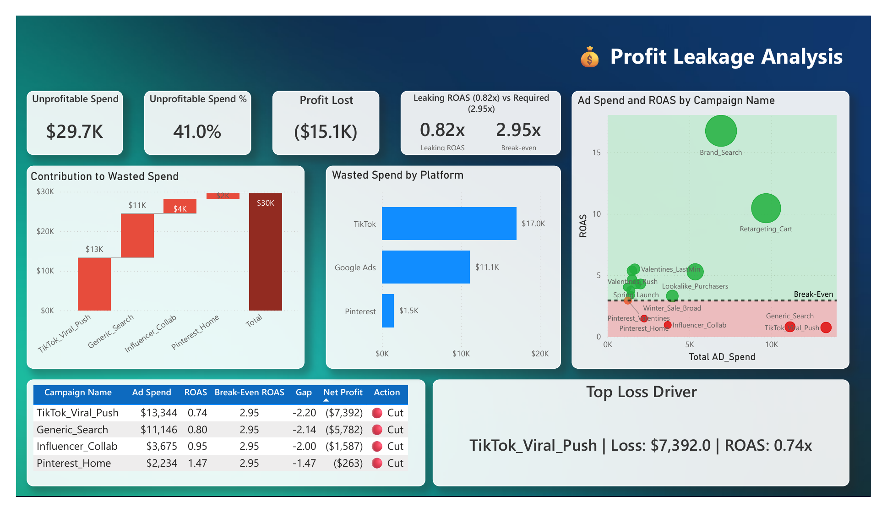
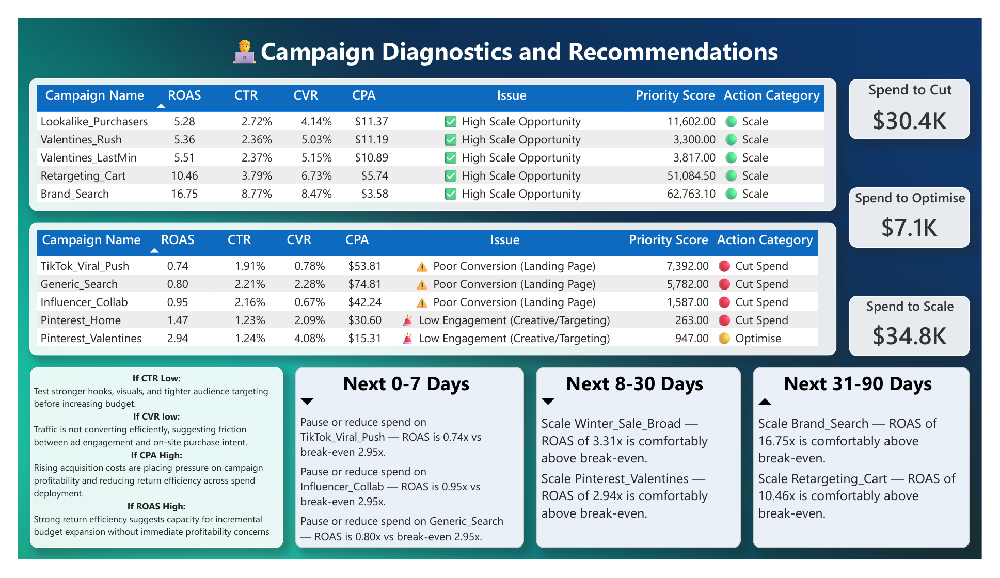

# Ad Spend Decision Dashboard

**Question:** Which of 20 ad campaigns across Google Ads, Meta, TikTok and Pinterest are making money, and where should the budget move?

## What I found
- **41% ($29.7K) of a $72.3K budget was unprofitable.** Those campaigns sat below the 2.95x break-even ROAS. Overall ROAS was 4.86x, so a few strong campaigns were hiding the losses.
- **The losses were a conversion problem, not a reach problem.** Across 5.8M impressions, 149K clicks and 6,010 conversions, the biggest drop came at conversion. Three loss-making campaigns had poor landing-page conversion.
- **The biggest single loss** was one TikTok campaign at 0.74x ROAS.

## What I recommended
- Every campaign is scored and labelled **scale, optimise or cut**.
- The action plan runs in three stages: 0–7 days (pause the worst campaigns), 8–30 days (scale the ones above break-even) and 31–90 days (grow the strongest).
- A conservative estimate: moving half the loss-making spend to the best campaigns could add about $65K profit.

## Built with
Power BI, DAX, funnel analysis, ROAS and break-even modelling.

| Profit leakage | Recommendations |
| --- | --- |
|  |  |

Full report: [ad-spend-decision-dashboard.pdf](ad-spend-decision-dashboard.pdf)
