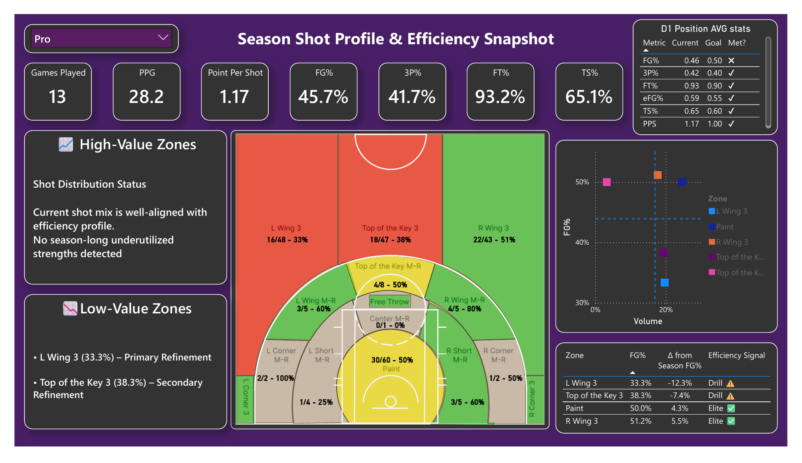
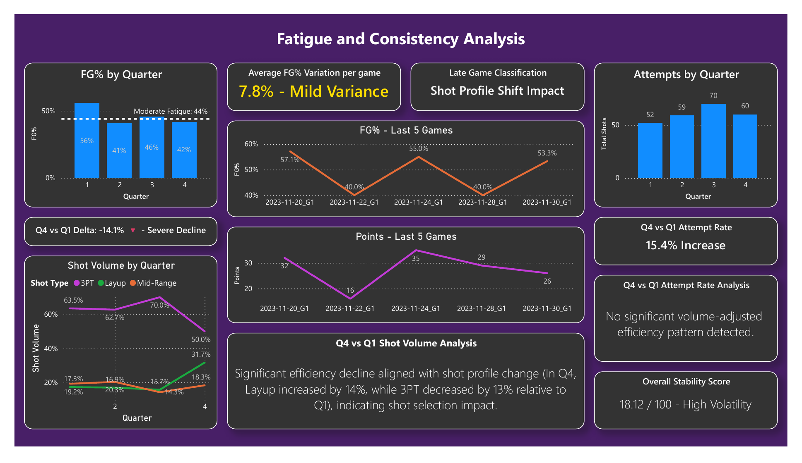
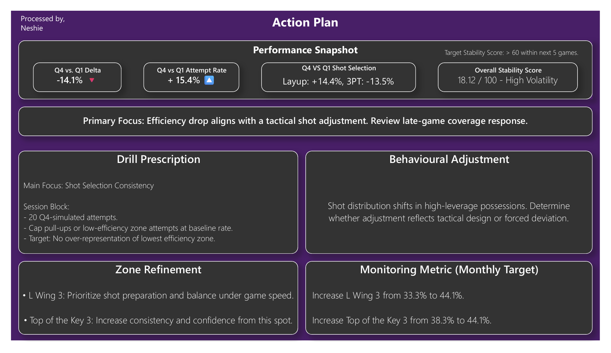

# Basketball Shot Tracker

**Question:** Where is a player losing shooting efficiency, and what exactly should they practise?

## The problem with standard visuals
Power BI's built-in visuals couldn't show shooting accuracy by court zone. So I taught myself SVG and coded a custom, colour-coded court map that shows makes, attempts and FG% for every zone.

## What it found (13 games)
- **Efficiency dropped late in games:** FG% fell from 56% in Q1 to 42% in Q4.
- **Shot selection changed with it:** by Q4, layups rose 14 points of shot share and three-pointers fell 13.
- **Two zones to work on:** left-wing threes (33%) and top-of-the-key threes (38%), both well below the season average.

## What it recommends
An action plan page turns the findings into a drill (20 simulated fourth-quarter attempts), zone priorities and monthly targets, such as raising left-wing threes from 33% to 44%. Performance is benchmarked against position averages.

I've shared the tracker with 7 players.

## Built with
Power BI, DAX, custom SVG visual. I went through 4 prototype versions to balance speed, clarity and ease of use.

| Fatigue analysis | Action plan |
| --- | --- |
|  |  |

Full report: [basketball-shot-tracker.pdf](basketball-shot-tracker.pdf)
