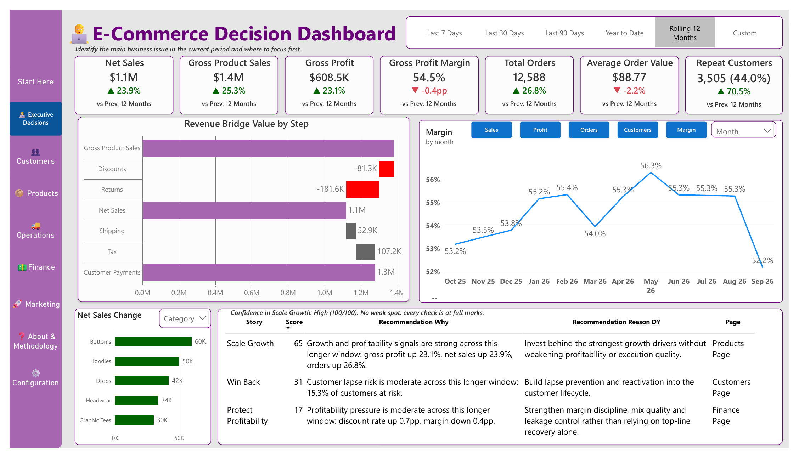
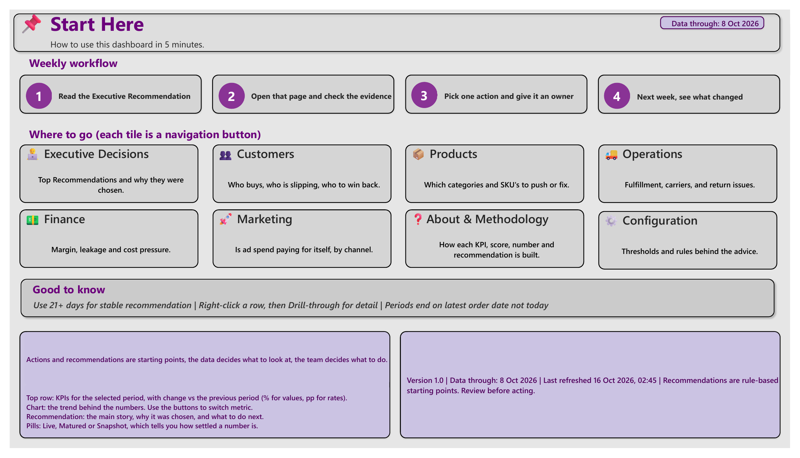
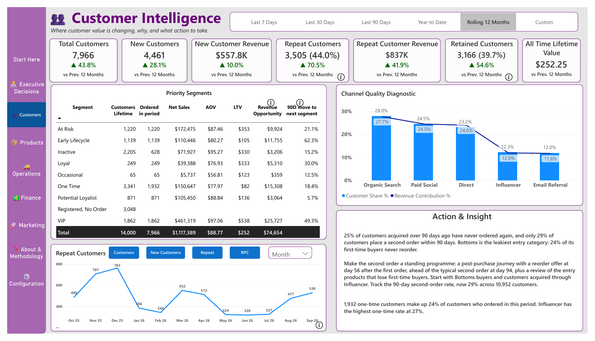
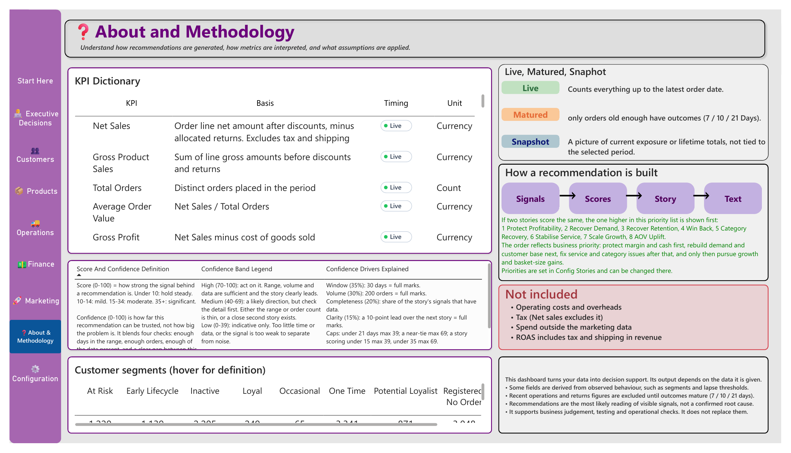

# E-Commerce Decision Dashboard

**Question:** An online clothing business has plenty of data but no clear answer to "what should we fix first?" This report gives that answer every week.

## What it does
- **9 report pages:** Start Here, Executive Decisions, Customers, Products, Operations, Finance, Marketing, About & Methodology and Configuration. Drill-through pages give segment, product and carrier detail.
- **Rule-based recommendations:** signals such as growth, customer lapse and margin leakage are scored, ranked and written as plain-English recommendations with a confidence score.
- **Built for a weekly routine:** read the top recommendation, check the evidence, give one action an owner, then review what changed next week.
- **Transparent logic:** a KPI dictionary and methodology page explain every measure, its timing (live, matured or snapshot) and the thresholds behind each recommendation.

## Scale
12,588 orders and 14,000 customers over a rolling 12 months, with segments from VIP and loyal to at-risk and inactive.

## Built with
Power BI (PBIP project format), DAX, data modelling, drill-through and tooltip pages.

## More pages
| Start Here | Customers | Methodology |
| --- | --- | --- |
|  |  |  |

Full report: [ecommerce-decision-dashboard.pdf](ecommerce-decision-dashboard.pdf)

<!-- Data source: say here whether this is a simulated dataset or real data used with permission. -->
